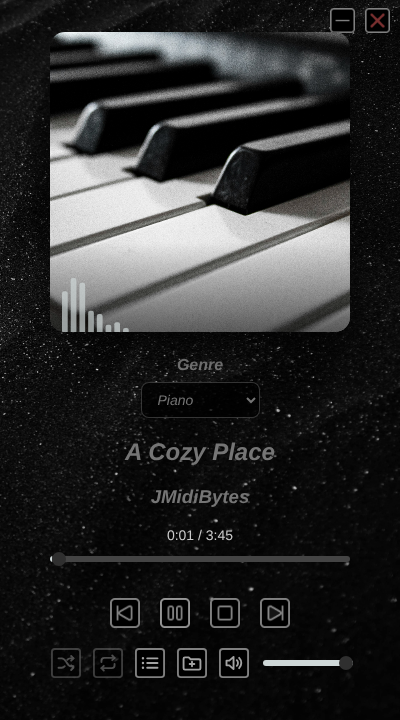
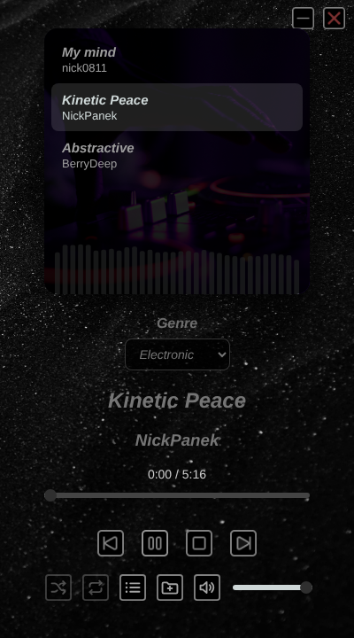
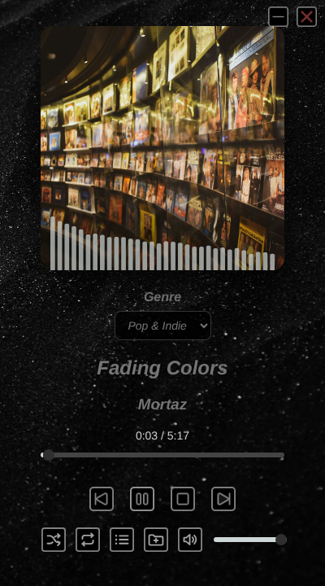

# Kumafy

[](https://github.com/MK-1379/kumafy/actions/workflows/ci.yml)
[](https://github.com/MK-1379/kumafy/releases/latest)

A compact desktop music player built with Electron and vanilla JavaScript. Pick a genre or open your own files, and watch the music move in a live audio visualizer.

**[Try the web demo](https://mk-1379.github.io/kumafy/)** · **[Download for Windows](https://github.com/MK-1379/kumafy/releases/latest)**

| Visualizer | Track list | Shuffle and repeat |
|---|---|---|
|  |  |  |

## Features

- Three genre playlists (Piano, Electronic, Pop & Indie) with royalty-free tracks
- Open your own audio files (MP3, WAV, OGG, FLAC, M4A, AAC) with the native file dialog
- Live audio visualizer built with the Web Audio API and a canvas
- Play/pause, stop, previous, next, seek bar, volume and mute
- Shuffle (Fisher-Yates) and three repeat modes: off, all and one
- Clickable track list
- Remembers the genre, track, volume, shuffle and repeat between sessions
- Keyboard shortcuts and media keys, with the current track shown in the Windows media overlay
- Accessible: real buttons with labels, visible focus, screen reader announcements and reduced motion support
- Runs in the browser too, as a web demo on GitHub Pages

## Keyboard shortcuts

| Key | Action |
|---|---|
| Space / K | Play or pause |
| ← / → | Seek 5 seconds |
| ↑ / ↓ | Volume up or down |
| N / P | Next or previous track |
| M | Mute |
| S | Shuffle |
| R | Repeat mode |
| L | Track list |
| O | Open audio files |
| Esc | Close the track list |

## Tech stack

- [Electron](https://www.electronjs.org/) (main process, preload script, IPC, custom protocol)
- HTML, CSS and vanilla JavaScript with ES modules
- Web Audio API, Canvas and Media Session API
- [Vitest](https://vitest.dev/) for unit tests and [Biome](https://biomejs.dev/) for linting and formatting
- GitHub Actions for CI, the web demo and releases
- [electron-builder](https://www.electron.build/) for the Windows installer

## How it works

**Security.** The window runs with `contextIsolation` and the Chromium sandbox, so it has no access to Node.js. The preload script exposes three functions and nothing else. A Content Security Policy only allows the app's own files, and the window cannot open popups or navigate away.

**Opening local files.** The window never sees file paths. When you pick files, the main process stores their paths in an allowlist and gives the window URLs like `kumafy-media://file/1`. A custom protocol handler serves only those files, supports HTTP range requests so seeking works, and answers 404 to anything else. In the browser, the same feature uses a file input and `blob:` URLs.

**Pure logic, tested.** Everything that decides something (play order, shuffle, repeat, saved state validation, keyboard mapping, range parsing, visualizer bars) lives in small functions without DOM access, covered by 59 unit tests. The DOM code only connects those functions to the interface.

## Download

Get the latest Windows installer from the [Releases page](https://github.com/MK-1379/kumafy/releases/latest).

> Windows may show a SmartScreen warning because the installer is not code-signed. Click **More info**, then **Run anyway**.

## Run from source

Requires [Node.js](https://nodejs.org/) 22 or later.

```bash
git clone https://github.com/MK-1379/kumafy.git
cd kumafy
npm install
npm start
```

| Command | What it does |
|---|---|
| `npm start` | Run the desktop app |
| `npm test` | Run the unit tests |
| `npm run lint` | Check formatting and lint rules |
| `npm run format` | Fix formatting |
| `npm run dist` | Build the Windows installer in `dist/` |

To try the web version locally, serve the folder over HTTP, for example with `npx serve .`.

## Releases

Pushing a tag such as `v1.2.0` runs the release workflow: it checks that the tag matches `package.json`, runs the tests, builds the installer on a Windows runner and publishes a GitHub release with notes generated from the merged pull requests.

## Project structure

```
.github/workflows/  CI, web demo deploy and release workflows
audio/              Bundled MP3 files
img/                Icons, background, app icon and genre covers
js/
  player.js         Connects the logic to the interface
  playback.js       Play order, shuffle, repeat and time helpers
  storage.js        Saves and validates the player state
  shortcuts.js      Keyboard shortcut mapping
  visualizer.js     Web Audio analyser and canvas drawing
  spectrum.js       Turns frequency data into bar heights
  local-files.js    Picks local files (native dialog or file input)
  tracks.js         Bundled genres and tracks
test/               Unit tests
index.html          Player interface
styles.css          Styles
main.js             Electron main process and media protocol
media-range.js      HTTP range header parsing
preload.js          Safe bridge between the window and the main process
```

## Adding your own tracks

For a one-off, use the open files button (or press O). To bundle a track with the app:

1. Copy the MP3 into `audio/`.
2. Add an entry to the matching genre in `js/tracks.js`:

```js
{ file: "song10.mp3", title: "My Song", artist: "Me" },
```

## Ideas for next versions

- Read ID3 tags (real artist, title and cover) from local files
- Keep adding local files instead of replacing the list
- Builds for macOS and Linux
- Automatic updates

## License

The source code is released under the [MIT License](LICENSE). Music and images keep their own licenses, listed below.

## Audio Credits

All tracks are used under the [Pixabay Content License](https://pixabay.com/service/license-summary/). Some tracks are AI-generated or AI-assisted, as flagged by their authors on Pixabay and noted below.

**Piano**
- "A Cozy Place" by JMidiBytes (Jerrell M Battle, Afflatus Music ASCAP) - [Link](https://pixabay.com/music/modern-classical-a-cozy-place-208105/)
- "Simple Melody Simple Life" by JMidiBytes (Jerrell M Battle, Afflatus Music ASCAP) - [Link](https://pixabay.com/music/modern-classical-simple-melody-simple-life-204492/)
- "Velvet Keys-Romantic LOVE1" by VelvetKeys (AI-generated) - [Link](https://pixabay.com/music/solo-piano-velvet-keys-romantic-love1-396670/)

**Electronic**
- "My mind" by nick0811 (AI-generated) - [Link](https://pixabay.com/music/synthwave-my-mind-528306/)
- "Kinetic Peace: High-Energy Pop Techno & Brostep Fusion" by NickPanek (AI-assisted) - [Link](https://pixabay.com/music/electronic-kinetic-peace-high-energy-pop-techno-amp-brostep-fusion-516569/)
- "Abstractive" by BerryDeep - [Link](https://pixabay.com/music/electro-abstractive-600233/)

**Pop & Indie**
- "tubevid music" by zience88 (AI-generated) - [Link](https://pixabay.com/music/pop-tubevid-music-174132/)
- "Fading Colors" by Mortaz - [Link](https://pixabay.com/music/indie-pop-fading-colors-456885/)
- "good day" by NeutralProduction - [Link](https://pixabay.com/music/beats-good-day-148366/)

## Image Credits

Cover photos, the app icon and the background are from [Unsplash](https://unsplash.com) and used under the [Unsplash License](https://unsplash.com/license).

- **Piano**: Photo by [Amir Doreh](https://unsplash.com/@amirdoreh) - [Source](https://unsplash.com/photos/cHUBZFjY13g)
- **Electronic**: Photo by [Marcela Laskoski](https://unsplash.com/@marcelalaskoski) - [Source](https://unsplash.com/photos/YrtFlrLo2DQ)
- **Pop & Indie**: Photo by [Anastasiya D](https://unsplash.com/@vasilechak) - [Source](https://unsplash.com/photos/ZBdspnFLWDg)
- **App icon**: "Music Notes" by [Logan Voss](https://unsplash.com/@loganvoss) - [Source](https://unsplash.com/photos/dm84sDkLfpQ)
- **Background**: "Grey sand wave" by [Adrien Olichon](https://unsplash.com/@adrienolichon) - [Source](https://unsplash.com/photos/RCAhiGJsUUE)